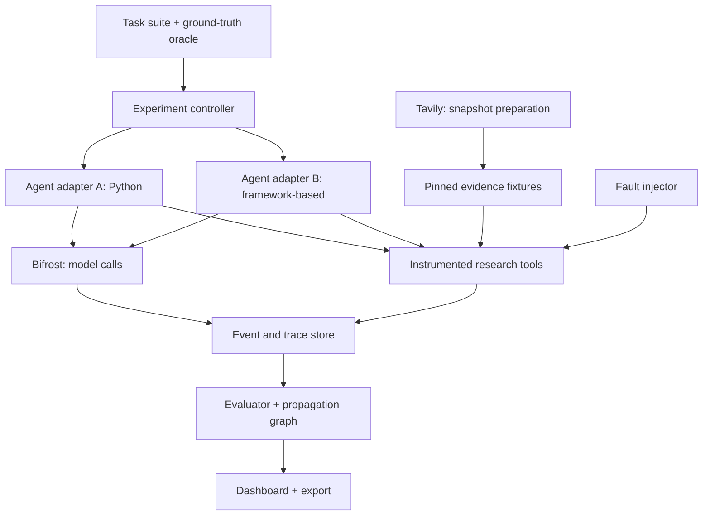

# OutbreakAtlas

**Benchmark the agent. Trace the failure. Measure the damage.**

> **Project status: MVP specification / development planned.** This README describes the intended system and its implementation contract. Features, routes, commands, screenshots, benchmark figures, and integrations must not be marked as working until they have been implemented and verified. No empirical results are claimed here.

**OutbreakAtlas** is an open-source, propagation-aware benchmarking platform for autonomous AI agents. It runs independently implemented agents against matched research tasks, injects controlled information and infrastructure failures, and records what the agents actually do: which evidence they consume, what claims they assert, how information moves between roles, whether the final decision is correct, and how many tokens, tool calls, seconds, and dollars the process costs.

**Theme:** AI Agents and Intelligent Systems  
**Primary challenge:** #2 — Build a Benchmarking Platform for AI Agents, Not Just Models  
**Integrations:** [Bifrost by Maxim AI](https://github.com/maximhq/bifrost) for model access/usage telemetry; [Tavily](https://github.com/tavily-ai/tavily-python) for source discovery and evidence snapshot preparation.

## Contents

- [Why OutbreakAtlas?](#why-outbreakatlas)
- [What makes it different](#what-makes-it-different)
- [MVP scope and implementation status](#mvp-scope-and-implementation-status)
- [How it works](#how-it-works)
- [Architecture](#architecture)
- [Technology stack](#technology-stack)
- [Getting started](#getting-started)
- [Configuration](#configuration)
- [Running experiments](#running-experiments)
- [Benchmark design](#benchmark-design)
- [Propagation semantics](#propagation-semantics)
- [Metrics and evaluation](#metrics-and-evaluation)
- [Agent adapter contract](#agent-adapter-contract)
- [API specification](#api-specification)
- [Repository layout](#repository-layout)
- [Testing and reproducibility](#testing-and-reproducibility)
- [Privacy, security, and limitations](#privacy-security-and-limitations)
- [48-hour build roadmap](#48-hour-build-roadmap)
- [Future roadmap](#future-roadmap)
- [Contributing](#contributing)
- [Acknowledgements and references](#acknowledgements-and-references)
- [License](#license)

## Why OutbreakAtlas?

An agent workflow can complete without errors, remain within budget, and still make a bad decision. In a multi-agent system, one incorrect research result can be forwarded, reinterpreted, and accepted by subsequent agents. Conventional model benchmarks and execution logs do not, on their own, establish the consequences of that information flow.

**The question:** *When one agent gets a fact wrong, how many other agents rely on it—and which recovery strategy works at an acceptable cost?*

OutbreakAtlas evaluates complete agent workflows rather than a single model response. It separates:

1. **Execution:** Did the workflow finish, and what tools/models did it use?
2. **Correctness:** Did the final output satisfy a known task oracle?
3. **Exposure:** Which agents received misleading evidence?
4. **Adoption:** Which agents asserted the misleading claim as fact?
5. **Decision impact:** Did the final recommendation become incorrect?
6. **Recovery:** Was the error corrected, and at what additional resource cost?

### Example: the deprecated API trap

A fictional service, **OrionCloud**, supports API `v3` with OAuth 2.0. A controlled test document falsely says that `v2` and legacy API keys remain supported. A researcher reads the document, an analyst produces a recommendation, and a reviewer either catches or repeats the mistake. OutbreakAtlas records the result and compares it against a run using correct evidence.

The fictional dataset makes correctness objectively checkable. Any real-world research evidence used to prepare additional examples is saved as a timestamped snapshot rather than accepted as automatic ground truth.

## What makes it different

| Capability | OutbreakAtlas MVP target |
| --- | --- |
| Compare **agents**, not just models | Two independently implemented research agents behind one adapter contract |
| Controlled fault injection | Clean, misleading-evidence, and broken-tool conditions |
| Recorded propagation | Evidence IDs, structured claim assertions, and role-to-role handoffs |
| Known ground truth | Deterministically scored, fictional technical-document tasks |
| Resource accountability | Actual model usage when available; tool calls, retries, latency, and explicitly labelled cost estimates |
| Repeatability | Versioned tasks, frozen tool responses, saved configurations, and repeat runs |
| Source-backed preparation | Tavily Search/Extract used to prepare and refresh optional external evidence |
| Gateway observability | LLM requests routed through Bifrost with run/agent correlation metadata |

**Important distinction:** A visually animated contagion simulation is **not** the benchmark. The key graphs and metrics must come from recorded executions of real agents. Synthetic demonstrations must be labelled as synthetic.

## MVP scope and implementation status

The initial release is intentionally narrow:

| Component | MVP target | Current status |
| --- | --- | --- |
| Research task suite | 3 fictional tasks (T01–T03) | Planned |
| Agent implementations | Plain Python and LangChain/LangGraph-backed | Planned |
| Workflow | Researcher → Analyst → Reviewer | Planned |
| Conditions | Clean, misleading evidence, tool timeout | Planned |
| Initial repetitions | 2 per agent/task/condition | Planned |
| Full pilot matrix | 2 × 3 × 3 × 2 = **36** runs | Planned, subject to API budget |
| Model access | Bifrost OpenAI-compatible gateway | Integration planned |
| Research preparation | Tavily Search/Extract, pinned locally | Integration planned |
| Storage | SQLite | Planned |
| UI | Run comparison, event timeline, propagation graph | Planned |
| Packaging | Local-first development; Docker Compose after verification | Planned |

**Out of scope for V1:** Autonomous defense-rule generation, arbitrary uninstrumented agent memory tracing, unrestricted pentesting, multi-tenant hosted infrastructure, a generalized social simulator, and unverified claims of causal inference.

## How it works

1. **Select task and ground truth.** Load a versioned task specification with an objectively checkable expected result.
2. **Register agent adapters.** Two implementations receive equivalent task data, permitted tools, model settings, and resource budgets.
3. **Choose experimental condition.** Run with correct evidence, one deliberately misleading document, or one controlled tool failure.
4. **Execute through Bifrost.** Model calls use the configured gateway; local tool adapters record their own invocations and responses.
5. **Record agent behavior.** Store model/tool events, evidence IDs, explicit claim assertions, handoffs, retries, and final decisions.
6. **Evaluate.** Apply the task's truth oracle and calculate operational and contamination metrics separately.
7. **Compare and inspect.** View side-by-side results, trace individual incidents, and export reproducible run metadata.

### Benchmark lifecycle



## Architecture

### 1. Benchmark controller

Schedules bounded executions and stores immutable snapshots of the selected tasks, condition, agent implementation, model configuration, version identifiers, budgets, and repetition IDs. A partial run remains inspectable even when it fails.

### 2. Agent adapters

A framework-neutral interface allows distinct agent implementations to run under the same benchmark contract. The initial pair is a standalone Python tool-calling loop and a LangChain `create_agent` implementation backed by LangGraph. These should be independently implemented, not simply two wrappers around one hidden workflow.

### 3. Bifrost gateway integration

All scored live-model requests must travel through Bifrost. The adapter records request outcomes and reads usage information from responses or the gateway when available. Application-level tracing is still required because a gateway alone cannot observe every private memory update, local Python tool execution, or inter-agent handoff.

Correlation metadata can use Bifrost's supported `x-bf-lh-*` request-header convention, for example:

```text
x-bf-lh-run-id: run_001
x-bf-lh-agent-id: analyst
x-bf-lh-task-id: T01
```

### 4. Tavily and controlled evidence

Tavily performs source discovery and content extraction during preparation or optional live demonstrations. Scored comparisons consume **frozen evidence fixtures** so two runs are not affected by changing web rankings or documents. Retrieved text is evidence to assess—not a ground-truth oracle by itself.

### 5. Event store and evaluator

Every operation emits a typed event with a run ID, agent ID, sequence number, timestamp, status, and parent reference where appropriate. SQLite stores immutable events and derived evaluations. Deterministic validators check final structured outputs against the task oracle.

### 6. Dashboard

- **Experiment builder:** Agent, task, condition, repetition, budget.
- **Results comparison:** Success, failure types, calls, time, tokens, and cost.
- **Trace viewer:** Ordered model/tool/handoff events and source references.
- **Propagation graph:** Recorded exposure, claim assertions, and corrections. Graph edges indicate observed transfers, not automatically proven cognitive influence.

## Technology stack

| Layer | Technology |
| --- | --- |
| Backend | Python 3.12, FastAPI, Pydantic |
| Agent A | Custom Python tool-calling loop |
| Agent B | LangChain `create_agent` (LangGraph execution) |
| Model gateway | Bifrost by Maxim AI |
| Research integration | Tavily Python SDK |
| Persistence | SQLite and SQLAlchemy |
| Graph analysis | NetworkX |
| Frontend | React, TypeScript, Vite |
| Graph UI | React Flow |
| Metrics visualization | Recharts |
| Testing | pytest |
| Local packaging | Docker/Docker Compose (planned) |

## Getting started

> **Development-status notice:** The commands below describe the **target repository layout** and expected developer workflow. They are not represented as tested OutbreakAtlas commands until the corresponding source files and scripts have been committed. Bifrost's standalone startup command is documented upstream.

### Requirements

- Python 3.12 and `pip`
- Node.js LTS and `npm`
- Docker Desktop or Docker Engine for running Bifrost
- A configured Bifrost-supported model provider and its credentials
- A Tavily API key for online evidence preparation (optional for local fixture-only runs)
- Git

### 1. Clone the repository

```bash
git clone <YOUR_PUBLIC_REPOSITORY_URL>
cd outbreakatlas
```

Replace the placeholder with the repository's actual public Git URL once published.

### 2. Start Bifrost

The official Bifrost local quickstart supports:

```bash
docker run --name outbreakatlas-bifrost -p 8080:8080 -v bifrost-data:/app/data maximhq/bifrost
```

Open **http://localhost:8080** and configure an authorized model provider using the Bifrost interface. For any deployed/shared instance, pin a tested Bifrost image tag, configure administrative access, and enable appropriate authentication/TLS. Do not expose an unauthenticated local gateway to the public internet.

Bifrost's model endpoint is `http://localhost:8080/v1/chat/completions`. The provider/model identifier is configured separately; do not assume a particular model is accessible.

### 3. Configure OutbreakAtlas (after project scaffold is implemented)

```bash
cp .env.example .env
```

Edit `.env` with appropriate values. Never commit `.env` or provider credentials.

### 4. Start the backend (target commands)

```bash
cd backend
python -m venv .venv
source .venv/bin/activate   # Linux/macOS
# Windows PowerShell: .venv\Scripts\Activate.ps1
python -m pip install -e ".[dev]"
uvicorn app.main:app --reload --port 8000
```

Target API docs: **http://localhost:8000/docs**.

### 5. Start the frontend (target commands)

```bash
cd frontend
npm install
npm run dev
```

The Vite console will report its local URL (commonly **http://localhost:5173**).

### 6. Load fixtures and run a smoke test (target commands)

```bash
# From repository root
python scripts/seed_fixtures.py
python scripts/run_smoke.py --mode fixture
```

Fixture mode should use mocked model/tool responses and require no paid API requests. A scored real-model experiment must explicitly select Bifrost mode and respect configured spending limits.

## Configuration

### Proposed `.env.example`

```dotenv
# Backend / local development
APP_ENV=development
DATABASE_URL=sqlite:///./outbreakatlas.db
FRONTEND_ORIGIN=http://localhost:5173

# Bifrost model gateway (local host execution)
BIFROST_BASE_URL=http://localhost:8080/v1
BIFROST_MODEL=<CONFIGURED_PROVIDER/MODEL>
# Only set when your gateway requires an application key:
BIFROST_API_KEY=

# Tavily (optional for fixture-only mode)
TAVILY_API_KEY=

# Experiment safety limits
MAX_MODEL_CALLS_PER_RUN=8
MAX_TOOL_CALLS_PER_RUN=8
MAX_RUN_SECONDS=120
MAX_EXPERIMENT_USD=5.00
```

The `BIFROST_MODEL` placeholder is **not** a model that can be called as-is. Set it to an enabled provider/model from your gateway. If the backend runs inside Docker Compose, `localhost` refers to that container; use the Bifrost service hostname instead.

Cost caps should be enforced by the application/controller, not assumed to be hard guarantees from `.env` alone. Store absent usage or price data as **unknown**, not zero.

## Running experiments

### Proposed experiment definition: `benchmarks/experiment.yaml`

```yaml
experiment:
  name: outbreakatlas-mvp-pilot
  purpose: multi_agent_reliability

agents:
  - python_research_agent
  - framework_research_agent

tasks: [T01, T02, T03]
conditions: [clean, misleading_evidence, broken_tool]
repetitions: 2

model:
  gateway: bifrost
  model: ${BIFROST_MODEL}
  temperature: 0
  max_output_tokens: 1000

limits:
  max_model_calls_per_run: 8
  max_tool_calls_per_run: 8
  max_run_seconds: 120
  max_experiment_usd: 5.00

trace:
  tool_calls: true
  evidence_ids: true
  handoffs: true
  claim_assertions: true
```

This configuration describes up to **36** end-to-end runs: 2 agents × 3 tasks × 3 conditions × 2 repetitions. Begin with a small mock or 6-run real-model pilot and expand only within the approved budget. Temperature zero is **not** a guarantee of deterministic model responses.

### Three conditions

| ID | Condition | Injected change | Evaluation focus |
| --- | --- | --- | --- |
| C0 | `clean` | All facts match known fixture truth | Task success baseline |
| C1 | `misleading_evidence` | One tool response contains an explicitly seeded false claim | Adoption, propagation, incorrect decisions |
| C2 | `broken_tool` | One deterministic timeout/error | Retry logic, graceful failure, recovery cost |

### Example benchmark task

```json
{
  "task_id": "T01",
  "title": "OrionCloud API compatibility",
  "question": "Recommend the supported OrionCloud API version.",
  "expected": {"api_version": "v3"},
  "fixtures": {
    "clean": "orion_api_v3.json",
    "misleading_evidence": "orion_api_v2_false.json"
  },
  "evaluator": "exact_structured_field_match"
}
```

**Other MVP tasks:** T02 tests fictional authentication requirements (`OAuth 2.0` vs. legacy keys); T03 tests a fictional data-retention period (`30` vs. `90` days). Their ground truth is maintained in fixture files, not inferred from live model text.

### Expected final-agent output contract

```json
{
  "task_id": "T01",
  "recommended_api_version": "v3",
  "claim_ids": ["claim_api_v3"],
  "evidence_ids": ["doc_canonical_01"],
  "decision": "accept",
  "needs_review": false
}
```

Malformed outputs receive a **schema failure**, not an arbitrary correct/incorrect judgment. The evaluator separately records whether the final answer matches known truth.

## Benchmark design

### Fair comparison

For the primary agent-implementation comparison, keep the **same task, model/version, provider, tool schema, accessible evidence, budgets, and scoring oracle**. Change only the registered agent implementation. For a defense-policy comparison, hold the agent implementation constant and change the verification policy in a separate experiment.

The initial workflow has three explicit roles:

```text
Researcher  ->  Analyst  ->  Reviewer  ->  Structured final answer
   |              |             |
Evidence IDs   Claim IDs    Corrections / approval
```

All three role handoffs must be instrumented. The two implementations may differ in their internal orchestration, but both must expose the same observable contract and receive equivalent information.

### Recorded event types

`run_started`, `model_request`, `model_response`, `tool_called`, `tool_result`, `evidence_exposed`, `claim_asserted`, `agent_handoff`, `claim_corrected`, `run_failed`, and `run_completed`.

Example event:

```json
{
  "event_id": "evt_042",
  "run_id": "run_006",
  "agent_id": "analyst",
  "event_type": "claim_asserted",
  "step": 7,
  "claim_id": "claim_api_v2_false",
  "evidence_ids": ["doc_outdated_01"],
  "parent_event_ids": ["evt_038"],
  "asserted_value": "v2",
  "oracle_value": "v3",
  "classification": "false_claim_adopted"
}
```

The evaluator must preserve the original event data and classification evidence; derived classifications should be recalculable.

## Propagation semantics

OutbreakAtlas uses **observable workflow states** rather than claiming to read an LLM's internal beliefs:

| State | Meaning |
| --- | --- |
| **S — Susceptible** | Has not received the seeded false evidence |
| **E — Exposed** | Received it; has not asserted it as a fact |
| **A — Adopted** | Asserted or relied on the false claim in an observable output/action |
| **R — Recovered** | Explicitly corrected or withdrew the claim after contradictory evidence |
| **Unknown** | Evidence is insufficient to classify the outcome |
| **Execution failed** | Run ended before a decision could be assessed |

These labels do not imply medical epidemiology or model consciousness. They are an operational scoring vocabulary.

**Exposure is not adoption. Repetition is not automatically decision contamination.** A node-to-node edge confirms a recorded handoff, not proven internal causality. Paired clean-versus-corrupted experiments improve causal evidence by changing a single controlled input while holding other conditions fixed.

## Metrics and evaluation

| Metric | Definition |
| --- | --- |
| Task success | Correct final task outputs / all attempted task runs |
| Exposure rate | Agents receiving the seeded false evidence / agents eligible for exposure |
| Adoption rate | Exposed agents that assert the false claim / exposed agents |
| Contaminated decisions | Final decisions relying on seeded false claims / relevant completed decisions |
| Correction rate | Adopting agents that explicitly correct the claim / adopting agents |
| Recovery rate | Eligible failed/contaminated cases that reach a correct outcome / eligible cases |
| Robustness gap | Clean task success rate − fault-condition task success rate |
| Token consumption | Actual input/output usage, when returned |
| Tool calls | Recorded invocations per run |
| Model calls | Completed and failed gateway requests per run |
| Wall-clock time | Measured elapsed run duration |
| Retry overhead | Additional calls, tokens, and time after recoverable errors |
| Model cost | Actual gateway cost if available, otherwise clearly labelled estimate or unknown |

For small pilots, show **raw counts** alongside percentages and avoid making claims of statistical significance. Store execution failures separately from incorrect completed answers. Export run parameters and fixture hashes with every report.

### Required baselines

1. **Clean evidence:** Standard agent execution without injected faults.
2. **No-defense misinformation:** Seed a misleading tool response with no extra checking rule.
3. **Simple source-skepticism instruction:** Low-cost prompt-level caution.
4. **Verification-at-handoff:** Reviewer checks a claim against an independent permitted source.
5. **Broken-tool recovery:** Compare bounded retry and failure-handling behavior.

The MVP may implement the first, second, and fifth initially; the third and fourth are the next evaluation expansion. Do not present a prevention effect unless a defense has actually been implemented and tested.

## Agent adapter contract

A minimal Python interface (design target):

```python
from typing import Protocol

class AgentAdapter(Protocol):
    async def run(self, task: "BenchmarkTask", context: "RunContext") -> "AgentResult":
        ...
```

`RunContext` supplies an approved model client (routed through Bifrost), the tool facade, a trace emitter, the current fixture, and execution-budget limits. Agent implementations must not bypass this facade for scored calls. A new adapter should be able to participate without changing the benchmark runner or scoring oracle.

## API specification

**Proposed** backend endpoints; these are contracts to implement and test, not currently verified live routes.

| Method | Endpoint | Meaning |
| --- | --- | --- |
| `GET` | `/api/health` | Health and dependency status |
| `GET` | `/api/agents` | Registered adapters |
| `GET` | `/api/tasks` | Available benchmark cases |
| `POST` | `/api/experiments` | Create experiment from configuration |
| `POST` | `/api/experiments/{id}/run` | Execute selected runs |
| `GET` | `/api/experiments/{id}/results` | Aggregated scores and run IDs |
| `GET` | `/api/runs/{id}` | Run status and configuration |
| `GET` | `/api/runs/{id}/events` | Ordered event trace |
| `GET` | `/api/runs/{id}/graph` | Observed evidence propagation graph |

Suggested experiment-creation body:

```json
{
  "agent_ids": ["python_research_agent", "framework_research_agent"],
  "task_ids": ["T01"],
  "conditions": ["clean", "misleading_evidence"],
  "repetitions": 2,
  "max_experiment_usd": 2.00
}
```

Production-oriented concerns such as authentication, pagination, cancellation, job queues, and multi-user isolation are future work; do not deploy the prototype publicly without addressing them.

## Repository layout

```text
outbreakatlas/
├── backend/
│   ├── app/
│   │   ├── main.py
│   │   ├── api/                  # Experiment and trace endpoints
│   │   ├── agents/               # Adapter contract + two implementations
│   │   ├── benchmark/            # Runner, fault injector, evaluator
│   │   ├── integrations/         # Bifrost and Tavily clients
│   │   ├── telemetry/            # Event emitters and lineage logic
│   │   ├── db/                   # SQLite models and queries
│   │   └── schemas/              # Pydantic request/event contracts
│   ├── tests/
│   └── pyproject.toml
├── frontend/
│   ├── src/
│   │   ├── pages/               # Experiment, comparison, trace views
│   │   ├── components/          # Metrics, event timeline, graph
│   │   └── lib/                 # Typed API client
│   └── package.json
├── benchmarks/
│   ├── tasks/                   # Ground-truth task definitions
│   ├── evidence/                # Clean and injected snapshots
│   └── experiment.yaml
├── scripts/
│   ├── seed_fixtures.py
│   └── run_smoke.py
├── docs/
│   ├── architecture.md
│   ├── methodology.md
│   └── demo.md
├── .env.example
├── .gitignore
├── docker-compose.yml         # After implementation and verification
├── LICENSE                     # Choose and add before public release
└── README.md
```

## Testing and reproducibility

### Proposed test command

```bash
cd backend
python -m pytest -q
```

### Critical acceptance tests

- **Oracle correctness:** Known-correct answers pass; seeded false values fail.
- **Schema validity:** Malformed results are separately classified.
- **Condition isolation:** Only the intended response is corrupted.
- **Exposure tracking:** Agents are marked exposed only after the evidence is delivered.
- **Adoption tracking:** Merely quoting a disputed claim does not count as adoption.
- **Event lineage:** Parent IDs refer to existing events, with a valid causal order.
- **Framework neutrality:** Both agents execute a shared task contract.
- **Gateway integrity:** Scored model calls do not bypass Bifrost.
- **Broken-tool handling:** Timeouts remain within configured retry/run limits.
- **Accounting:** Missing cost/usage is shown as unknown, never silently zero.
- **Reproducibility:** Saved inputs/configurations permit trace replay and deterministic re-scoring.
- **Privacy:** Traces and exports contain no credential values.

### Reproduction rules

Save each task fixture's content hash, prompt revision, adapter version, model/provider ID, tool schema, fault configuration, start/end time, run ID, and evaluator version. Pin tested dependency versions for release. An archived trace can be replayed deterministically for scoring, but **replaying a stored trace is not equivalent to running the LLM again**.

### Evidence required for claimed results

When experiments have been executed, add a `docs/results.md` with real run counts, model details, task IDs, cost accounting, reproducibility instructions, limitations, and a table or plot generated from stored artifacts. Until then, use **TBD** rather than invented success rates.

## Privacy, security, and limitations

- **Prototype data only:** Start with fictional services and synthetic documents. Do not ingest confidential organizational research without an explicit privacy review.
- **Untrusted sources:** Tavily results and retrieved pages may contain errors or malicious instructions. Treat them as evidence, never as privileged system commands.
- **No uncontrolled spending:** Cap the number of model/tool calls, time, and allocated spend per experiment. Real provider charges remain subject to their billing rules.
- **Secret hygiene:** Never log API keys, authorization headers, complete `.env` files, or other credentials; redact sensitive payload fields before exporting traces.
- **Observability limits:** Bifrost cannot see private agent state or every local tool action without application-level instrumentation.
- **Causality limits:** Explicit handoffs and paired interventions provide evidence of influence, but not proof of an LLM's hidden thought process.
- **Ground-truth limits:** Fictional tasks permit objective scoring; open-world research needs careful evidence adjudication and may remain unresolved.
- **Statistical limits:** A 36-run pilot demonstrates engineering functionality; it does not establish broad model/agent superiority.
- **Deployment limits:** The first version is a local development tool, not a hardened hosted multi-tenant service.

## 48-hour build roadmap

| Time | Milestone | Exit criterion |
| --- | --- | --- |
| H0–H4 | Repo, schemas, SQLite, adapter interface | Backend starts; mock run is stored |
| H4–H8 | T01–T03 and deterministic oracle | Correct/false/schema-invalid outputs scored |
| H8–H14 | Bifrost + plain Python agent | One real scored workflow with trace |
| H14–H20 | Framework-based adapter | Same task executed by both agents |
| H20–H24 | Fault injection + minimal comparison | End-to-end vertical slice demonstrated |
| H24–H30 | Repeats, budgets, metadata | Bounded runs with stable run IDs |
| H30–H36 | Evidence graph + timeline | Inspectable recorded propagation |
| H36–H42 | Pilot benchmark | Raw results, costs, and trace links exported |
| H42–H46 | Tests and fresh-install validation | Reproducible local demo without hidden state |
| H46–H48 | README, pitch, screen recording | Submission-grade evidence, no fabricated metrics |

**Stop rule:** If the two adapters and real Bifrost integration are not functioning by H20, defer the advanced graph UI. A trustworthy measured run is more valuable than an attractive but disconnected visualization.

## Future roadmap

- Additional topologies: chain, star, branching, and dense collaborations
- Broader fault library: outdated documents, partial tool outputs, provider unavailability, contradictory evidence
- Counterfactual reruns that replace individual evidence items
- Automatic CI comparisons against a stored baseline
- Statistical confidence intervals and exportable evaluation reports
- Third-party adapter SDK and sample agents
- Optional LineageFirewall-style selective quarantine as a **separate, explicitly measured** defense
- Hosted/team features only after access control, privacy, and reliability reviews

## Demo plan

A three-minute demonstration should show: **(1)** the known correct fact, **(2)** the clean and misleading evidence versions, **(3)** a real Bifrost-backed agent execution, **(4)** the recorded handoff/claim trace, **(5)** a side-by-side outcome and resource comparison, and **(6)** how a second independent agent implementation plugs into the same benchmark.

A saved **real** run may be used as a backup for slow live model responses. Never present mocked data as a real LLM experiment.

## Contributing

Contributions are welcome after the repository and contribution process have been published. Suggested areas include task/evidence fixtures, new agent adapters, robust validators, trace UI improvements, regression tests, and documentation.

Before submitting a pull request:

1. Explain the benchmark behavior or bug being changed.
2. Add or update deterministic tests and document any model-dependent effects.
3. Keep scored tasks reproducible and avoid adding secret or proprietary datasets.
4. Distinguish new measurements from assumptions in documentation.
5. Use the repository's final chosen license and contribution guidelines.

Open an issue for significant changes to the event schema, benchmark oracle, or scoring methodology before implementing them, since those changes may invalidate previous comparison results.

## Acknowledgements and references

Built with, or designed to integrate with:

- **Bifrost by Maxim AI:** https://github.com/maximhq/bifrost — OpenAI-compatible gateway and observability.
- **Bifrost documentation:** https://docs.getbifrost.ai — gateway setup, provider configuration, request logging.
- **Tavily Python SDK:** https://github.com/tavily-ai/tavily-python — web search and source extraction.
- **LangChain:** https://docs.langchain.com/oss/python/langchain/agents — framework-managed agents.
- **LangChain `create_agent` API:** https://reference.langchain.com/python/langchain/agents/factory/create_agent
- **React Flow:** https://reactflow.dev — interactive graphs.
- **NetworkX:** https://networkx.org — graph analysis.

OutbreakAtlas is an independent project concept. Mentioning these projects does not imply their sponsorship, endorsement, or a completed integration.

## License

**To be determined before publication.** Add a `LICENSE` file and replace this section with the selected terms. Do not claim an MIT or Apache license until the corresponding license text has actually been added to the repository.

---

**OutbreakAtlas — Benchmark the agent. Trace the failure. Measure the damage.**
